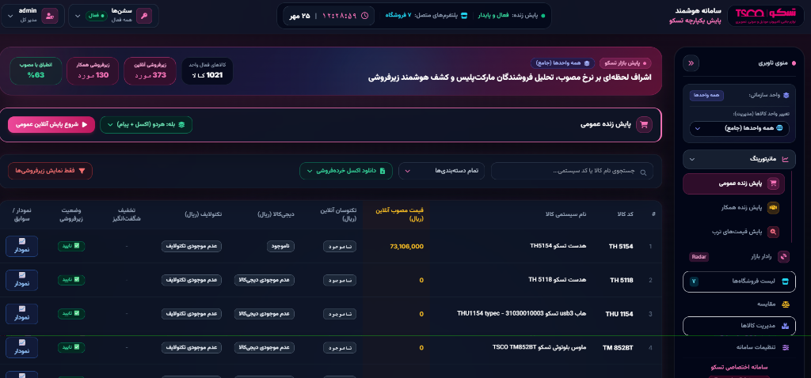

# سامانه هوشمند پایش بازار، استخراج داده و تحلیل قیمت
### Market Intelligence & Automated Web Scraping Platform

[](https://github.com/Hawk8724/Web-scraping-and-data-analyzer)
[](https://github.com/Hawk8724/Web-scraping-and-data-analyzer)
[](https://github.com/Hawk8724/Web-scraping-and-data-analyzer)
[](https://github.com/Hawk8724/Web-scraping-and-data-analyzer)
[](https://github.com/Hawk8724/Web-scraping-and-data-analyzer)

---

## 📌 معرفی کلی سامانه

در بازارهای رقابتی و پویای امروز، **شفافیت داده‌ها و رصد لحظه‌ای نوسانات قیمت** یکی از کلیدی‌ترین ارکان تصمیم‌گیری برای تولیدکنندگان، برندها و سازمان‌های تجاری است. 

این پروژه یک **پلتفرم جامع، هوشمند و خودکار برای جمع‌آوری داده‌ها (Web Scraping)، انطباق کاتالوگ و تحلیل قیمت بازار** است. هدف اصلی این سامانه، رفع نیاز به بررسی‌های فرسایشی و خطاپذیر دستی، رصد پیوسته رفتار فروشگاه‌های آنلاین و کانال‌های عمده‌فروشی، کشف سریع انحرافات قیمتی (مانند موارد زیرفروشی یا تخفیف‌های خارج از مصوبه) و ارائه گزارش‌های تحلیلی و لحظه‌ای به مدیران بازار است.

> [!IMPORTANT]
> ### 🌐 قابلیت تعمیم به تمامی کالاها و برندها (Brand & Product Agnostic)
> اگرچه نسخه نمونه و اولیه این پلتفرم برای بازار قطعات و لوازم دیجیتال پیاده‌سازی و تنظیم شده است، اما **معماری هسته سامانه کاملاً مستقل، ماژولار و مقیاس‌پذیر** طراحی شده است:
> * **هرگونه برند و شرکت:** قابلیت پوشش و مانیتورینگ محصولات مربوط به هر تولیدکننده یا واردکننده در تمامی صنایع.
> * **تمامی دسته‌بندی‌های کالایی:** از لوازم دیجیتال، صوتی و گیمینگ گرفته تا کالاهای تندمصرف (FMCG)، لوازم خانگی، آرایشی و بهداشتی، قطعات یدکی و ابزارآلات صنعتی.
> * **انطباق هوشمند:** شناسایی کالاها از طریق کدهای اختصاصی سازمانی، بارکد، عنوان تجاری کالا و پیوندهای مستقیم در فروشگاه‌ها.

---

## 🧭 ارکان اصلی و کانال‌های پایش

این سامانه پایش بازار را در دو سطح کلان و تکمیلی به اجرا درمی‌آورد:

```
┌────────────────────────────────────────────────────────────────────────┐
│                        موتور یکپارچه پایش و تحلیل                      │
└──────────────────┬──────────────────────────────────┬──────────────────┘
                   │                                  │
         ▼                                  ▼
┌─────────────────────────────┐    ┌─────────────────────────────┐
│    ۱. پایش کانال‌های عمومی  │    │    ۲. پایش کانال‌های همکار  │
│       (خرده‌فروشی آنلاین)   │    │      (توزیع و عمده‌فروشی)    │
├─────────────────────────────┤    ├─────────────────────────────┤
│ • مارکت‌پلیس‌های معتبر       │    │ • شبکه‌های توزیع B2B        │
│ • موتورهای جستجوی کالا      │    │ • پایش سطح فروش همکار       │
│ • استخراج تمامی فروشندگان   │    │ • حفظ انضباط قیمتی عمده     │
│ • تفکیک موجودی و تخفیف‌ها   │    │ • جلوگیری از شکست قیمت      │
└─────────────────────────────┘    └─────────────────────────────┘
                   │                                  │
                   └──────────────────┬───────────────┘
                                      ▼
                   ┌─────────────────────────────────────┐
                   │    داشبورد مدیریتی، هشدار و گزارش   │
                   │ • نمودار تاریخچه نوسانات هر فروشگاه │
                   │ • ارسال خودکار پیام و فایل اکسل     │
                   │ • زمان‌بندی هوشمند خودکار بدون اپراتور│
                   └─────────────────────────────────────┘
```

### ۱. پایش آنلاین و مارکت‌پلیس‌های عمومی (Public Marketplaces)
* خزش هوشمند و خودکار بزرگ‌ترین فروشگاه‌های اینترنتی و موتورهای مقایسه قیمت کشور.
* استخراج قیمت لحظه‌ای مصرف‌کننده، رصد موجودی و ناموجود شدن کالاها.
* تفکیک کامل فروشندگان مختلفی که روی یک کالا فعالیت دارند (شناسایی دقیق فروشنده اصلی و فروشندگان متفرقه).
* سنجش درصد و میزان انحراف قیمت هر فروشگاه با نرخ مصوب شرکت، و برچسب‌گذاری خودکار موارد مشکوک یا زیرفروشی.

### ۲. پایش کانال‌های عمده‌فروشی و پنل‌های همکار (B2B Price Monitoring)
* رصد نظام توزیع عمده و بازارهای همکار به‌منظور حمایت از نمایندگان متعهد و ثبات قیمت در کل زنجیره تأمین.
* مقایسه نرخ‌های ارائه‌شده در درگاه‌های همکار با قیمت پایه و مصوب عمده‌فروشی.
* کنترل پیوسته قیمت‌ها بدون نیاز به دخالت روزانه نیروی انسانی، جهت پیشگیری از آسیب به ارزش برند و رقابت‌های ناسالم در بازار عمده.

---

## ⚡ قابلیت‌های برجسته سامانه

```
📈 داشبورد مدرن و زنده     ⏰ زمان‌بندی خودکار پایش    📊 گزارش‌گیری هوشمند اکسل
👥 سطوح دسترسی چندگانه     📉 نمودار روند و تاریخچه    🔔 هشدار سریع در پیام‌رسان
```

| محور عملکردی | شرح توانمندی |
| :--- | :--- |
| **داشبورد تحلیلی و لحظه‌ای** | رابط کاربری مدرن، سریع و واکنش‌گرا با تم تیره/روشن، فیلترهای آنی بر اساس واحد سازمانی، دسته‌بندی و وضعیت زیرفروشی. |
| **نمودار تفکیکی تاریخچه قیمت** | ثبت دائمی تمام سوابق قیمتی در طول زمان و رسم نمودار تحلیلی روند نوسانات به تفکیک فروشگاه‌ها در برابر نرخ‌های مبنا. |
| **کارنامه تفکیکی فروشندگان** | ایجاد پروفایل مستقل برای هر فروشگاه یا فروشنده جهت بررسی سوابق رعایت مقررات قیمتی و تعداد کالاهای فعال. |
| **زمان‌بندی هوشمند (Auto-Scheduler)** | امکان برنامه‌ریزی اجرای پایش‌های روزانه در ساعات دلخواه به صورت کاملاً خودکار و مستقل از اپراتور انسانی. |
| **خروجی‌های سازمانی و اتوماسیون** | تولید خودکار گزارش‌های اکسل دقیق با فرمت‌بندی استاندارد و ارسال مستقیم خلاصه‌وضعیت‌ها به کانال‌ها یا گروه‌های مدیریتی سازمانی در پیام‌رسان‌ها. |
| **امنیت و تفکیک نقش‌ها** | کنترل دسترسی چندسطحی برای مدیران ارشد، مدیران واحدها و کارشناسان با قابلیت پایش مستقل هر دپارتمان یا واحد کالایی. |

---

## 🖼️ پیش‌نمایش محیط برنامه

در تصویر زیر، نمای کلی از داشبورد یکپارچه سامانه، جداول پایش کالاها و شاخص‌های آماری قابل مشاهده است:



---

## 🏗️ جریان عملکرد سامانه (Operational Workflow)

1. **مدیریت و بارگذاری کاتالوگ:** اطلاعات پایه کالاها، دسته‌بندی‌ها و قیمت‌های مبنا از طریق پایگاه داده یا فایل‌های اکسل سازمانی به سیستم تزریق می‌شود.
2. **اجرای خودکار یا دستی پایش:** خزش اطلاعات به صورت زمان‌بندی‌شده یا با درخواست لحظه‌ای کاربر برای تمام فروشگاه‌ها یا یک فروشگاه منتخب آغاز می‌گردد.
3. **تطبیق و صحت‌سنجی داده‌ها:** الگوریتم‌های انطباق، اطلاعات استخراج‌شده را با کالای هدف مقایسه کرده و در صورت وجود انحراف قیمتی یا تخفیف‌های خارج از مصوبه، آن را دسته‌بندی می‌کنند.
4. **تولید بینش و اعلان فوری:** گزارش‌های تحلیلی نهایی در داشبورد ثبت شده و هم‌زمان خلاصه گزارش‌ها همراه با فایل‌های تفکیکی به پنل مدیران ارسال می‌شود.

---

## 🔒 محرمانگی و مالکیت معنوی (Proprietary & Enterprise Notice)

* این مخزن منحصراً به‌عنوان **معرفی قابلیت‌ها، مستندات مفهومی و معماری اجرایی سامانه** نگهداری می‌شود.
* به‌منظور صیانت از محرمانگی الگوریتم‌های خزش و حفاظت از زیرساخت‌های سازمان، سورس‌کدهای اختصاصی و ماژول‌های دسترسی به داده‌ها به صورت **Closed-Source و پکیج اجرایی مستقل** نگهداری می‌شوند و در این مخزن قرار نگرفته‌اند.

---

<div align="center">
  <sub>طراحی و پیاده‌سازی شده برای ارتقای شفافیت زنجیره تأمین و پایش هوشمند بازارهای آنلاین و توزیع</sub>
</div>
